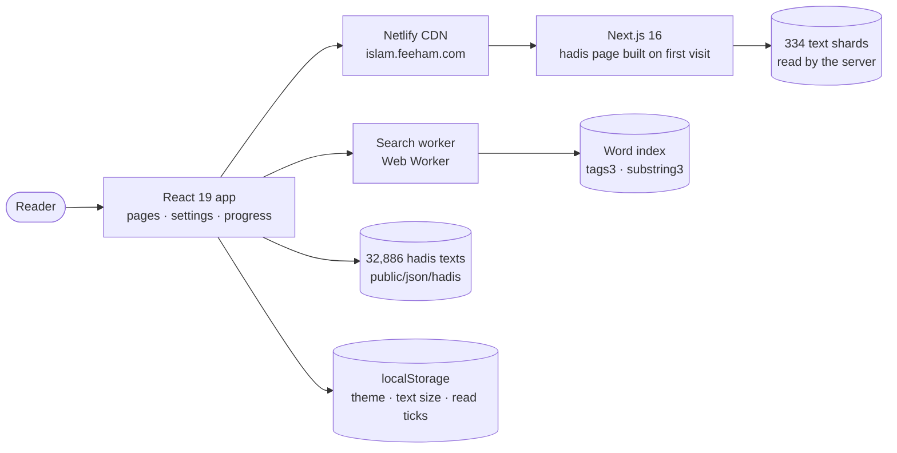
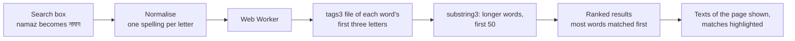
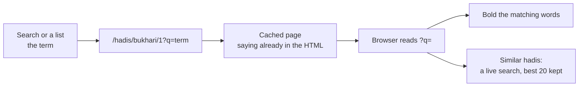
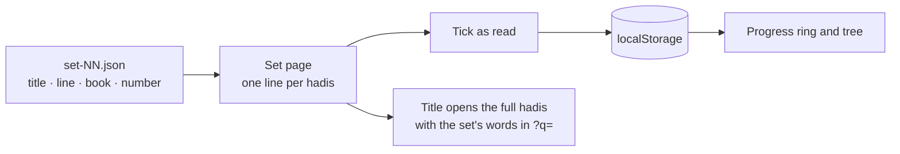
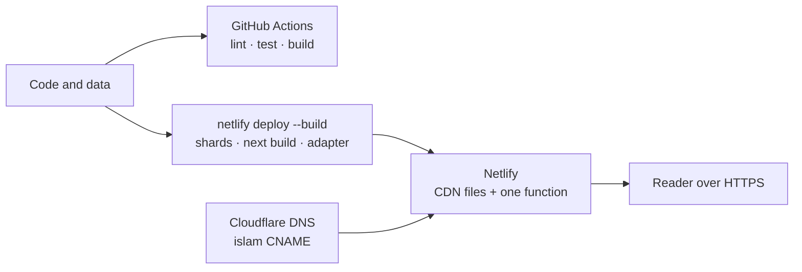

<div align="center">

# Alhashor · কুরআন ও হাদীস সম্ভার

**A Bengali library of hadis (the six major books) and Quran tafsir (Kanzul Iman & Khazainul Irfan).**
32,886 hadis · instant search with no search server · hand-picked reading lists · one cached page per hadis · light, dark and sepia.

<sub>Live site: <a href="https://islam.feeham.com">islam.feeham.com</a></sub>

</div>

---

## At a glance

| | |
|---|---|
| **Content** | Bukhari, Muslim, Tirmidhi, Abu Dawud, Ibn Majah and Nasa'i: 32,886 hadis, 203 topics, every narrator, 12 hand-picked sets (290 hadis) |
| **App** | Next.js 16 (App Router) and React 19, plain CSS, 161 source files, about 8,700 lines, 15 routes |
| **Data** | Static JSON under `public/json`: the texts, a word index cut at three letters, longer-word lists, narrators. No database |
| **Search** | Runs in the browser in a Web Worker over small index files. English letters turn into Bengali as you type |
| **Pages** | A hadis page is built on its first visit, then cached for a year (incremental static regeneration) |
| **Privacy** | No accounts, analytics, trackers, CDN fonts or third-party scripts. Settings and reading progress stay on the device |
| **Verification** | 2,104 automated tests (132 test files), ESLint with zero warnings, headless-Chrome checks for layout, themes and network |

## Quick start

Requirements: Node 20.9 or newer (the browser scripts under `scripts/` need Node 22+), Google Chrome only for those scripts.

```bash
npm ci             # install
npm run dev        # http://localhost:3000
npm run build      # production build (first packs the hadis texts into .data/hadis)
npm start          # serve the build on :3000
npm test -- --run  # the test suite once
```

Nothing else to start: there is no database, queue or second service. The full reference (features in detail, data layout, search switches, data scripts, checks) follows below.

## What it does

- **Search**: a word, a phrase, a hadis number or a narrator. Counts per book, filters, the matched words highlighted, a "near words" mode, and "did you mean" for spelling.
- **Read**: a calm hadis page with the narrator chain folded, reading time, copy, cite and link buttons, previous/next with arrow keys or a swipe, and a live list of similar hadis.
- **Continue where you were**: open a hadis from a search or a list and the words you came with are bold, carried in the address (`?q=`).
- **Browse**: six colour-coded books, a jump bar for a number, 203 topics, and every narrator with the number of his hadis.
- **Popular hadis**: themed sets chosen by hand, each hadis with a one-line title, a "read" tick and a progress ring that never leave your device.
- **Every day**: a hadis of the day (the same for everyone, from the date alone) with an RSS feed, and a share page that draws a quote card in the browser.
- **Make it yours**: light, dark or sepia; text size 3 to 30 px; line gap; works on a phone with a bottom tab bar, and has a web app manifest so Chrome can offer to install it.

## Architecture



| Part | What it is |
|---|---|
| `src/app` | The routes: home, search, books, hadis, share, topics, narrators, daily, top-picks, settings, sitemaps, robots, RSS |
| `public/json/hadis` | One text file per hadis (32,886), read by the browser, and packed into 334 shards for the server |
| `public/json/tags3`, `substring3` | The word index: word to hadis tags, and word to longer words that contain it (9,655 and 6,123 small files) |
| `src/search` | The search engine: query rules, ranking, "did you mean", the Web Worker client |
| `src/data/topPicks` | The twelve hand-picked sets, one JSON file each |
| `netlify.toml`, `next.config.mjs` | Netlify build through its Next.js adapter, headers, and which files ship in the server function |

### Key flows

**Search**: a query becomes a handful of small index files, never a server call.



**Opening a hadis**: the same cached page for everyone; the words you came with are bolded in your browser.



**Popular hadis**: hand-picked sets in plain JSON; progress is kept on the reader's device.



**From a change to the live site**: one build on the command line, served from islam.feeham.com.



### Why it is built this way

| Choice | Reason |
|---|---|
| Static JSON, no database | The data never changes, so every file can be cached forever and nothing has to run at read time |
| Word index in 3-letter files | A search opens a few small files, not one big one; a longer-word list with a cap of 50 keeps common words cheap |
| One cached page per hadis | The saying is in the first HTML for search engines and link previews, built once and kept for a year |
| The term in `?q=`, read in the browser | Reading the address on the server would make every page uncacheable; the browser bolds the words after load instead |
| Progress in `localStorage` | No accounts to build or protect; the reader's data stays with the reader |

## Showcase

A 15-slide presentation of the site (a Mac monitor on desktop, a phone on mobile, a Light / Dark toggle for the screenshots, dark by default, and the architecture and flow animations) lives in the myworks portfolio, outside this repository: `FeehamEcosystem/apps/myworks`, project `alhashor`. Run `npm run dev:myworks` there and open http://localhost:5182/p/alhashor. Its screenshot tour (`npm run capture:alhashor`) captures every screen from this site running on port 3000.

## Engineering notes

- **Self-contained.** Everything ships with the app. A headless-Chrome check records every network request of the main pages and fails if one goes to another host.
- **Both spellings.** The data spells some Bengali letters two ways (`য়` as one character or two, `ো` as one or as `ে` + `া`). Search, highlighting and index file names all treat them as one letter.
- **Accessible by default.** ESLint runs `jsx-a11y` with zero warnings allowed; the keyboard walk, focus rings and the screen-reader names of the controls are checked in the browser scripts.
- **Cost-aware hosting.** The pages, sitemaps and text shards are built so that later visits cost a CDN request only. Notes on credits are in `netlify.toml`.
- **Known issue.** The CI run on GitHub currently fails: the 3-letter index folders hold file-name pairs that differ only in how a Bengali letter is spelled, which macOS cannot keep as two files but Linux can. A search for words in those pairs may miss hadis until the folders are regenerated on Linux.

---

## Features

- **Search** (`/search?q=&book=&page=`): by word, phrase, hadis number or narrator. English letters typed in the box turn into Bengali as you type (for example `namaz` becomes নামায; the Avro phonetic library, with a few curated spellings), and anything that is not Bengali or an English letter or digit is refused with a short warning. Book filter chips show a count per book. Each result shows the text around the match with the matched words highlighted.
- **Books** (`/books`, `/books/<book>?page=`): a picker of the six colour-coded books; a book page has a slim switcher, a title band with a "go to number" box at its right end (digits only, Bengali or English, for the open book), a one-line range strip that scrolls sideways (one chip per hundred numbers), the range label and pager on one row, and a list of the same cards as the search page. Pages hold 20 hadis that exist, so numbers with no data file are skipped.
- **Topics** (`/topics?topic=&page=&book=&sort=desc`): a letter-block menu of the 203 topics, curated by what people look for (docs/topics-review.md; a sticky sidebar from 900px, a full-screen overlay on phones) with a search box and an ascending/descending sort, and the topic's hadis shown as the `/search` listing for its name (`src/search/SearchResults.jsx`, shared with the search page). The curated "start here" block (`src/data/curatedTopics.js`) is switched off.
- **Narrators** (`/narrators?name=<id>&page=&book=&sort=`): the same layout as Topics, but the menu lists every narrator as one row with the number of hadis at its right (most hadis first by default; sticky sidebar from 900px, full-screen overlay on phones). The search row stays on top while the list scrolls, with a sort select of four options: hadis count high to low (default), low to high, name ক → হ and name হ → ক (the two name sorts bring back the letter blocks); the address holds `&sort=count-asc|name-asc|name-desc` (the old `&sort=desc` and `&sort=asc` still work). For the chosen narrator the listing of search and topics (count line, book chips with counts, plain cards, boxed pager, 20 to a page) from the static files in `public/json/narrators`.
- **Hadis page** (`/hadis/<book>/<number>`): calm reading column, folded narrator chain, reading time and progress line, copy / cite / link buttons, previous and next (arrow keys and swipe), breadcrumb back to the book.
- **Share** (`/share/<book>/<number>`): citation, share text, native share sheet and a quote-card image drawn on a canvas in the browser (download or share).
- **Daily** (`/daily`): hadis of the day, chosen from the date with no randomness, always from the owner's featured top-picks sets (`FEATURED_SET_NUMBERS` in `src/lib/featuredSets.js`: sets 5, 1, 4, 6, 2, the display positions 1, 2, 4, 5 and 7 of the জনপ্রিয় হাদীস list; the Home top list picks its three random sets from the same five; pool built by `src/lib/dailyPool.js`, de-duplicated, in set order). Today and the previous seven days are all different, the whole pool is used once before any hadis repeats, and the RSS feed uses the same pool. There is no fallback: the pool is the only source (an empty pool shows no hadis of the day).
- **Top picks, টপ লিস্ট/হাদীস** (shown as জনপ্রিয় হাদীস in the top bar, the phone bottom tab (জনপ্রিয়) and the Home card) (`/top-picks`, `/top-picks/<set id>`): the owner's hand-picked hadis in themed sets (`src/data/topPicks/set-01.json` to `set-12.json`, read by `src/lib/topPicks.js`), then the three older plans (রমযান, ছোট হাদীস, উত্তম চরিত্র). One compact card per set (a colour tile with a list icon, the title which wraps and is never cut, the count and description, and "আপনি পড়েছেন N/M" with a small progress ring: red below 33%, yellow below 66%, green above, a tick at 100%); a set with no hadis is not listed; a set page is a hadis-by-hadis checklist with progress kept on the device only. The old addresses `/daily?tab=plans` and `/daily?tab=plans&plan=<id>` redirect permanently (`next.config.mjs`).
- **Similar hadis**: under each hadis page, a live search with the meaningful words of the whole hadis (common words removed, at most 25 longest words), the best 20 kept, 5 shown and "আরও সদৃশ হাদীস" shows 5 more each time. The hadis page is a stack of cards as wide as the list pages.
- **Home**: the hero with the search bar, a টপ লিস্ট/হাদীস section (three random sets out of the five featured ones, chosen in the browser after mount, titles only with a "পড়ুন" label), a row of four cards (জনপ্রিয় হাদীস, বর্ণনাকারী, বিষয়ভিত্তিক হাদীস, আজকের হাদীস) and the books shelf, হাদীসের বই.
- **Themes and reading settings** (`/settings`): light (the default for everyone, whatever the device prefers), dark, sepia, or an explicit choice to follow the device; text size (3 to 30 px), line gap (0.5 to 2.5) and Bengali or English digits. Saved on the device only.

## Run it

Needs Node 20.9 or newer (`.nvmrc` says 20). The browser scripts under `scripts/` need Node 22 or newer.

```sh
npm ci            # install
npm run dev       # dev server at http://localhost:3000
npm run build     # production build (first runs `prebuild`: packs the hadis texts into .data/hadis)
npm start         # serve the production build at http://localhost:3000
npm test          # Vitest in watch mode; npm test -- --run runs once
npm run lint      # ESLint, zero warnings allowed (includes jsx-a11y)
```

## Server rendering, link previews and SEO

A hadis page (`/hadis/<book>/<number>`) is rendered on the server, so the saying, the title and the link-preview tags (description, canonical address, Open Graph, Twitter card) are in the first HTML that search engines and chat apps read. Pages are not built ahead of time (33,000 of them): each is built on its first visit and then cached for a year (`revalidate`; a hadis text never changes). `/share/<book>/<number>` is cached the same way and marked `noindex`.

- **Text for the server.** `npm run build` runs the `prebuild` script, `scripts/build-text-shards.mjs`, which packs every text into `.data/hadis/<CODE>-<n>.json` (100 hadis per shard, 334 files, about 40 MB, git-ignored). `next.config.mjs` ships them with the hadis route and the RSS route; `src/lib/hadisServer.js` reads them (and falls back to the files in `public/json/hadis` when the shards are absent, as in tests).
- **`SITE_URL`.** Absolute addresses come from `src/lib/site.js`: `NEXT_PUBLIC_SITE_URL` or `https://islam.feeham.com`. Set the variable for another domain.
- **Sitemaps and robots.** `/sitemap.xml` is an index of six sitemaps, `/sitemap/0.xml` to `/sitemap/5.xml`, one per book (every hadis that exists, plus the main pages in the first). `robots.txt` (`src/app/robots.js`) allows everything except `/search`, `/share/` and `/settings`. All of them are built at build time.
- **RSS.** `/daily/rss.xml` is the hadis of the day for the last 14 days (dates in Bangladesh time), rebuilt at most hourly, announced from `/daily` with a `<link rel="alternate">`.
- **Not done:** per-hadis preview images (Bengali text in generated images is unreliable); every link preview uses the site logo.

## Repo layout

```
src/
  app/        routes (Next.js App Router): page.jsx, search, books/[book], hadis/[book]/[number],
              share/[book]/[number], topics, daily, top-picks, settings, not-found; layout.jsx loads the stylesheets
  shell/      top bar, phone tab bar (with the More menu), no footer
  home/       home page            search/   search page, box, filters, results, searchIndex.js
  books/      book pages           topics/   shared name menu (topics, narrators), start-here block
  hadis/      hadis page, shared hadis card, similar-hadis list
  daily/      daily card                   topPicks/ top picks list, set page    share/  quote card and share logic
  settings/   settings store, provider, page, inline theme script
  ui/         Button, Chip, Icon, BookBadge, Toast
  styles/     tokens.css (colours, three themes) plus one stylesheet per area; plain CSS, no framework
  lib/        pure logic with tests: books list, number parsing, daily pick, top picks, share text,
              card layout, topics, Roman-letter converter, search box input rules, digits
  data/       hand-written content: curated topic picks, reading plans, the top picks sets (data/topPicks)
  Helpers/    page title, paging, URL params, Bengali normalising, back-to-top
  assets/fonts/  the three font families (SIL Open Font License), served by next/font/local
  test/       test helpers (real-data fetch stub, Next router mocks, canvas stub)
public/json/
  hadis/<Book>/<0001>/text.txt   one hadis (a JSON string); folders Bukhari, Muslim, Tirmiji, Daud, Majah, Nasae
  tags/<first two letters>.json  word -> tags of hadis containing it (e.g. "BUK-124"); 1,645 files
  tags3/<first three letters>.json  the same words cut at three letters (a word of fewer than three
                                 letters: the whole word and "_"); 9,655 files, 21.6 MB, made from
                                 tags/ by scripts/build-index-3.mjs. The search reads these by default;
                                 ?idx=2 on /search switches back to tags/ (see src/search/searchConfig.js)
  substring/<first two letters>.json  word -> longer words containing it; 1,164 files, 8.6 MB. Each list
                                 is sorted by the words' hadis count, the most first (reordered in place by
                                 scripts/sort-substring-2.mjs; the words are the same), so the cap works here too
  substring3/<first three letters of the word>.json  the same keys cut at three letters (a key of fewer
                                 than three letters: the whole key and "_"); 6,123 files, 8.6 MB, the
                                 largest কার.json 126 KB (the largest 2-letter file is 351 KB). Each list is
                                 sorted by the words' hadis count, the most first, so the search can take
                                 the first N (the cap). Made from substring/ and tags/ by
                                 scripts/build-substring-3.mjs. The search reads these by default
  related/<CODE>-<n>.json        up to 3 related hadis per hadis, 100 hadis per shard (BUK-0.json ...);
                                 no longer read by the site (the hadis page searches live), kept until the owner decides
docs/         redesign-plan.md (decisions, phases, deviations), redesign-ideas.md, design/ (D2 and D5 references)
```

Tests sit next to the code they cover (`*.test.js`, `*.test.jsx`). Some use the real files in `public/json`.

### Search switches

The search reads its settings from `src/search/searchConfig.js`. Three of them can be overridden on the page address of `/search` at any moment (a developer switch: nothing in Settings; an invalid value is ignored, and a switch stays in the address while the visitor searches again). The page hands the values to the Web Worker with each request.

| Switch | Values | Default | What it does |
|---|---|---|---|
| `?idx=` | `2`, `3` | `3` | word files: `tags/` (2 letters) or `tags3/` (3 letters) |
| `?sub=` | `2`, `3` | `3` | containing-word files: `substring/` or `substring3/` |
| `?cap=` | `0` (off), `1` to `500` | `50` | how many of the longer words that contain a query word have their `tags` file loaded: the first N of the word's list (the ones with the most hadis). Works with both `?sub=2` and `?sub=3`, because the lists of `substring/` and `substring3/` are sorted the same way |

The four modes under test, and the address switches for each:

| Mode | Switches | Behaviour |
|---|---|---|
| 2-letter files, cap off | `?idx=2&sub=2&cap=0` | the old behaviour; every containing word is loaded (2,068 `tags` files for 20 common words) |
| 2-letter files, cap | `?idx=2&sub=2&cap=50` | the first 50 containing words of each list: 269 files for the same 20 words, 98.2% of the hadis kept |
| 3-letter files, cap off | `?idx=3&sub=3&cap=0` | the same hadis in the same order as the 2-letter files, but many more files (4,913) |
| 3-letter files, cap | `?idx=3&sub=3&cap=50` | the default: 361 files, the same 98.2% of the hadis kept |

With the cap off, the 2-letter and the 3-letter files return the same hadis in the same order (a golden test checks 56+ queries); with the cap on, the two return the same hadis too, as the lists are the same. The measured numbers are in `docs/redesign-plan.md`.

## Self-contained rule

Everything ships with the app: no database, no CDN fonts, analytics, third-party scripts or APIs, no hosted storage or accounts. Fonts are files in `src/assets/fonts`. The only storage is the visitor's own device (`localStorage`: `alhashor.settings`, `alhashor.plan-progress`). Details are in section 11 of `docs/redesign-plan.md`.

Checks (they use headless Google Chrome; the default path is the macOS one, override it with `CHROME=/path/to/chrome`). Build first, then run each against a server. `scripts/with-server.sh <port> "<start command>" <command...>` starts the server, waits for it, runs the command and stops the server:

```sh
npm run build
scripts/with-server.sh 3000 "npm start" scripts/check-self-contained.sh http://localhost:3000
scripts/with-server.sh 3000 "npm start" scripts/smoke.sh http://localhost:3000
scripts/with-server.sh 3000 "npm start" node scripts/browser-checks.mjs http://localhost:3000
scripts/with-server.sh 3000 "npm start" node scripts/theme-shots.mjs http://localhost:3000 /tmp/shots
```

- `check-self-contained.sh <base-url> [extra-route ...]` loads `/`, a search, `/topics` and `/books` (plus any extra routes) in headless Chrome, records every network request in a Chrome net-log and fails if the page asked for any other host (`outside-hosts.py` reads the log).
- `smoke.sh <base-url>` checks status codes (data files served, missing data is a real 404, bad hadis and book addresses are 404), that deep links render real content in the browser, and the exact page title of each route on a fresh load.
- `browser-checks.mjs <base-url>` drives Chrome through `browser.mjs` (a small dependency-free DevTools driver): paging lands at the top, a saved dark theme is applied, a keyboard walk (tab order, focus rings, Enter opens the narrator chain, arrow keys move between hadis, no sideways overflow at narrow widths), and the books jump box, pager and range grid.
- `theme-shots.mjs <base-url> <out-dir>` screenshots home, search, results, a hadis, books, a book, topics, a topic and settings in all three themes at 390 and 1200 px, and fails on sideways overflow or a theme not applied. It does not cover `/daily` or `/share`.
- `screenshots.sh <base-url> <out-dir> [WxH]` takes plain screenshots of the main pages; `compare-screenshots.py <dir-a> <dir-b>` diffs two folders of them (needs Pillow).

## Data scripts

Run once from the repo root when the data changes. These scripts read the files under `public/json`.

- `node scripts/build-index-3.mjs` regroups `public/json/tags/*.json` into `public/json/tags3/<first three letters>.json` (no network; the same output every time; it reads `tags/` and replaces `tags3/`; `src/lib/indexShards.test.js` checks that both folders hold the same words and tags). Run it again whenever `tags/` changes.
- `node scripts/build-substring-3.mjs` regroups `public/json/substring/*.json` into `public/json/substring3/<first three letters of the key>.json` and sorts each list by the words' hadis count (read from `public/json/tags`), the most first, ties by code point order (no network; the same output every time; about 4 s; it replaces `substring3/`). `src/lib/substringShards.test.js` checks that both folders hold the same (key, word) pairs and that every list is sorted. Run it again whenever `substring/` or `tags/` changes.
- `node scripts/build-related.mjs` writes `public/json/related/<CODE>-<n>.json`: for each hadis up to 3 related ones, by words they share weighted by rarity, with a small bonus for another book; two near-identical texts in different books are marked as the same report. The method is described at the top of the script. The site no longer reads these files (the similar list is a live search now); the script and the files are kept for now.
- `node scripts/build-stopwords.mjs [--threshold=750] [--report=<file>]` writes `src/data/stopwords.json`: the words that are in more than 750 of the hadis (301 words), counted from `public/json/tags`. The similar-hadis search leaves them out, together with words of one or two letters and words with digits (`src/lib/similarWords.js`).

## Deploy notes

Netlify runs the Next.js app through its adapter (`@netlify/plugin-nextjs`, named in `netlify.toml`). `netlify.toml` builds with `npm run build` on Node 20, sets cache and CORS headers for `/json/*` and `/photos/*`, and explains in comments how the site saves the free plan's credits (cached pages, no middleware, texts inside the function) and what to check on the first real deploy. `.github/workflows/ci.yml` installs, lints, tests and builds on every push and pull request; its deploy step (`netlify deploy --build --prod`, which builds and deploys in one go) is switched off with `if: false`. Nothing here is pushed or deployed for now. Section 10 of `docs/redesign-plan.md` has the platform decision and what is unverified until a real deploy.

## Notes

- Some hadis numbers have no data file (334 in Bukhari's range, 5 in Nasa'i). Pages show "this hadis was not found" for them, and previous / next skip them.
- Searches match a normalized Bengali spelling because the data spells some letters two ways (`src/Helpers/bengali.js`, `src/search/searchIndex.js`).
- `public/photos/` holds images from the old site that no page uses now (the headers and `smoke.sh` still mention it).
